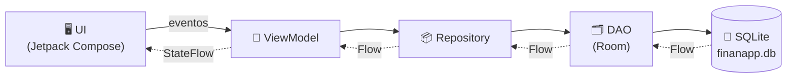

<div align="center">

# 💰 FinanApp

### Control de gastos personales para Android

Registra tus ingresos y gastos, consulta tu balance en tiempo real y descubre en qué se va tu dinero con estadísticas visuales.


[**⬇️ Descargar APK**](apk/FinanApp.apk) · [Características](#-características) · [Arquitectura](#-arquitectura) · [Instalación](#-instalación-y-ejecución)

</div>

---

## 📑 Tabla de contenido

- [Acerca del proyecto](#-acerca-del-proyecto)
- [Características](#-características)
- [Tecnologías](#-tecnologías)
- [Arquitectura](#-arquitectura)
- [Persistencia de datos](#-persistencia-de-datos)
- [Instalación y ejecución](#-instalación-y-ejecución)
- [Pruebas](#-pruebas)
- [Demostración](#-demostración)
- [Autoras](#-autoras)

---

## 📌 Acerca del proyecto

**FinanApp** es una aplicación móvil nativa para Android que ayuda a las personas a llevar el control de sus finanzas. Cada movimiento (ingreso o gasto) se registra con **descripción, valor, categoría y fecha**. La aplicación calcula el balance disponible de forma automática y ofrece estadísticas para saber en qué categorías se gasta más.

> Proyecto académico desarrollado para la asignatura **Tópicos Avanzados en Ingeniería**, programa de **Ingeniería de Sistemas**, Universidad Francisco de Paula Santander Ocaña (UFPSO).

---

## ✨ Características

| Código | Funcionalidad | Pantalla |
|:------:|---------------|----------|
| **RF01** | Dashboard con balance disponible, total de ingresos, total de gastos y los últimos 5 movimientos | `DashboardScreen` |
| **RF02** | Registro de ingresos y gastos con validaciones: campos obligatorios, valor mayor que cero, categorías según el tipo y selector de fecha | `FormularioMovimientoScreen` |
| **RF03** | Listado de movimientos con filtros por tipo y categoría, edición y eliminación con confirmación | `MovimientosScreen` · `DetalleMovimientoScreen` |
| **RF04** | Recálculo automático del balance al registrar, editar o eliminar | `FinanzasViewModel` |
| **RF05** | Estadísticas: resumen, gráfico de dona ingresos vs. gastos, gastos por categoría y categoría con mayor gasto | `EstadisticasScreen` |

### 🏷️ Categorías

| Tipo | Categorías |
|------|------------|
| 🟢 **Ingresos** | Salario · Ventas · Freelance · Inversiones · Otros ingresos |
| 🔴 **Gastos** | Alimentación · Transporte · Vivienda · Servicios · Salud · Educación · Entretenimiento · Otros gastos |

---

## 🛠️ Tecnologías

| Tecnología | Versión | Uso |
|------------|:-------:|-----|
| Kotlin | `2.0.21` | Lenguaje de programación |
| Jetpack Compose + Material 3 | BOM `2024.04.01` | Interfaz de usuario declarativa |
| Navigation 3 | `1.2.1` | Navegación entre pantallas |
| Room | `2.6.1` | Persistencia local sobre SQLite |
| KSP | `2.0.21-1.0.28` | Generación de código para Room |
| Lifecycle ViewModel | `2.7.0` | Manejo del estado de la UI |
| Kotlin Coroutines + Flow | — | Operaciones asíncronas y datos reactivos |
| Kotlinx Serialization | `1.6.3` | Rutas de navegación serializables |
| Android Gradle Plugin | `8.9.1` | Compilación |

**Configuración del proyecto:** `minSdk 24` (Android 7.0) · `targetSdk 35` · `compileSdk 36` · Java 17

---

## 🏗️ Arquitectura

El proyecto sigue el patrón **MVVM (Model–View–ViewModel)** con una capa **Repository**:



### 📁 Estructura del código

```
app/src/main/java/com/ufpso/finanapp/
├── data/
│   ├── model/Movimiento.kt              # Entidad, TipoMovimiento, ResumenFinanciero, Categorias
│   ├── local/MovimientoDao.kt           # Consultas SQL (CRUD)
│   ├── local/AppDatabase.kt             # Base de datos Room (Singleton)
│   └── repository/MovimientoRepository.kt
├── ui/
│   ├── components/Componentes.kt        # Tarjetas, ítems, diálogos y gráficos (Canvas)
│   ├── navigation/Rutas.kt              # Rutas (NavKey)
│   ├── navigation/AppNavigation.kt      # NavDisplay y pila de navegación
│   ├── screens/                         # Dashboard, Formulario, Movimientos, Detalle, Estadísticas
│   ├── theme/                           # Colores, tipografía y tema
│   └── viewmodel/FinanzasViewModel.kt   # Balance, filtros, estadísticas y CRUD
├── util/Formato.kt                      # Formato de pesos colombianos y fechas
└── MainActivity.kt
```

### 🧩 Responsabilidad de cada capa

| Capa | Responsabilidad |
|------|-----------------|
| **Model** | Define la entidad `Movimiento` (id, descripción, valor, categoría, fecha, tipo). |
| **DAO** | Declara las consultas a la base de datos. `obtenerTodos()` devuelve un `Flow`. |
| **Repository** | Es el único punto de acceso a los datos y aísla la UI del origen de datos. Decide si un movimiento se inserta (`id = 0`) o se actualiza. |
| **ViewModel** | Transforma los datos en estado para la UI (`StateFlow`): resumen, balance, gastos por categoría y lista filtrada. Sobrevive a las rotaciones de pantalla. |
| **UI** | Pantallas en Compose que observan el estado mediante `collectAsState()`. |

### 🧭 Navegación

Se utiliza **Navigation 3**. Las rutas son objetos y clases `@Serializable` que implementan `NavKey`. La pila de navegación (`backStack`) es una lista:

- **Navegar** a una pantalla → `backStack.add(ruta)`
- **Volver** → eliminar el último elemento de la pila
- Las rutas `Formulario(id)` y `Detalle(id)` reciben el id del movimiento como parámetro.

---

## 💾 Persistencia de datos

Se eligió **Room**, la librería oficial de Android Jetpack para bases de datos locales, que funciona como una capa de abstracción sobre **SQLite**.

### ¿Cómo funciona?

1. La clase `Movimiento` está anotada con `@Entity`, y Room genera la tabla `movimientos`.
2. `MovimientoDao` define las operaciones con `@Insert`, `@Update`, `@Delete` y `@Query`.
3. `AppDatabase` crea una única instancia (patrón **Singleton**) del archivo `finanapp.db`.
4. Las operaciones de escritura son funciones `suspend` que se ejecutan en corrutinas sin bloquear la interfaz.

### ¿Por qué Room?

- ✅ **Datos persistentes:** se conservan al cerrar y volver a abrir la aplicación.
- ⚡ **Reactivo:** el DAO devuelve un `Flow`; cada inserción, edición o eliminación emite la nueva lista y el ViewModel recalcula balance y estadísticas sin recargar la pantalla.
- 🛡️ **Validación en compilación:** las consultas SQL se verifican al compilar, evitando errores en tiempo de ejecución.
- 🗃️ **Adecuado para los datos:** los movimientos tienen una estructura fija (tabular), por lo que una base de datos relacional es más apropiada que SharedPreferences o DataStore.

---

## 🚀 Instalación y ejecución

### 📲 Opción 1: Instalar el APK

1. Descarga [`apk/FinanApp.apk`](apk/FinanApp.apk).
2. Cópialo a tu celular (o arrástralo al emulador).
3. Habilita la instalación desde **orígenes desconocidos** y ábrelo para instalar.

### 💻 Opción 2: Compilar desde el código fuente

**Requisitos**

- Android Studio (versión reciente compatible con AGP 8.9)
- JDK 17 (incluido en Android Studio)
- Emulador o dispositivo con Android 7.0 (API 24) o superior

**Pasos**

```bash
git clone https://github.com/LuisaFernanda-1/FinanApp.git
```

1. Abre la carpeta del proyecto en Android Studio (**File → Open**).
2. Espera a que Gradle sincronice las dependencias (**Sync Now**).
3. Crea o inicia un emulador desde **Device Manager**.
4. Presiona **Run ▶** para instalar y ejecutar la aplicación.

> 💡 Para generar el APK nuevamente: **Build → Generate App Bundles or APKs → Generate APKs**. El archivo queda en `app/build/outputs/apk/debug/app-debug.apk`.

---

## 🧪 Pruebas

| # | Caso de prueba | Resultado esperado |
|:-:|----------------|--------------------|
| 1 | Registrar un ingreso de $2.500.000 | Balance: **$2.500.000** |
| 2 | Registrar un gasto de $350.000 (Alimentación) | Balance: **$2.150.000** |
| 3 | Registrar un gasto de $150.000 (Transporte) | Balance: **$2.000.000** |
| 4 | Intentar guardar con campos vacíos o valor 0 | Se muestran mensajes de error |
| 5 | Editar un movimiento | El balance se recalcula |
| 6 | Eliminar un movimiento | Se pide confirmación y el balance se actualiza |
| 7 | Filtrar por tipo y por categoría | Solo se muestran los movimientos que coinciden |
| 8 | Cerrar y volver a abrir la app | Los datos se conservan |
| 9 | Revisar las estadísticas | Los totales coinciden con los movimientos registrados |

---

## 🎬 Demostración

📹 _Video de demostración: https://drive.google.com/file/d/1WR903290oSmQkiHtPv8xARcDqCicTRgj/view?usp=sharing

---

## 👩‍💻 Autoras

| Nombre | Código |
|--------|:------:|
| **Luisa Fernanda Ovallos Carrascal** | 01992245 |
| **Geily Nathalia Duran Torrado** | 0191973 |

<div align="center">

**Universidad Francisco de Paula Santander Ocaña (UFPSO)**
Ingeniería de Sistemas · Tópicos Avanzados en Ingeniería · Examen 2

</div>
